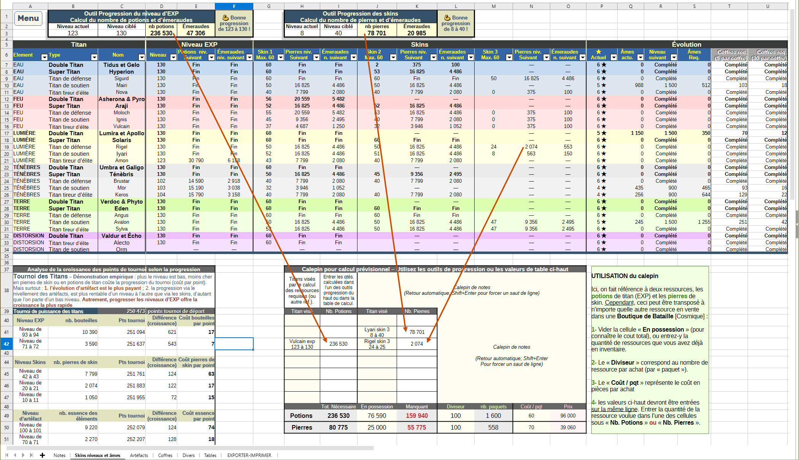
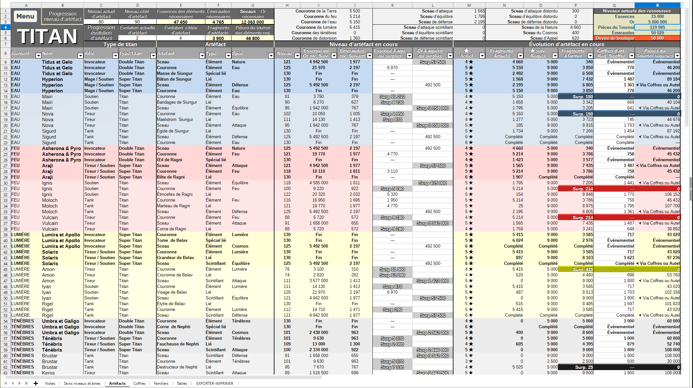
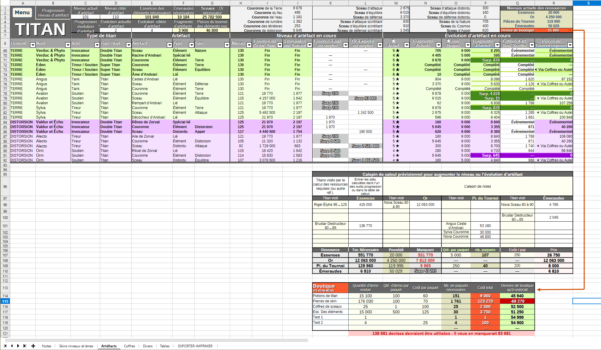
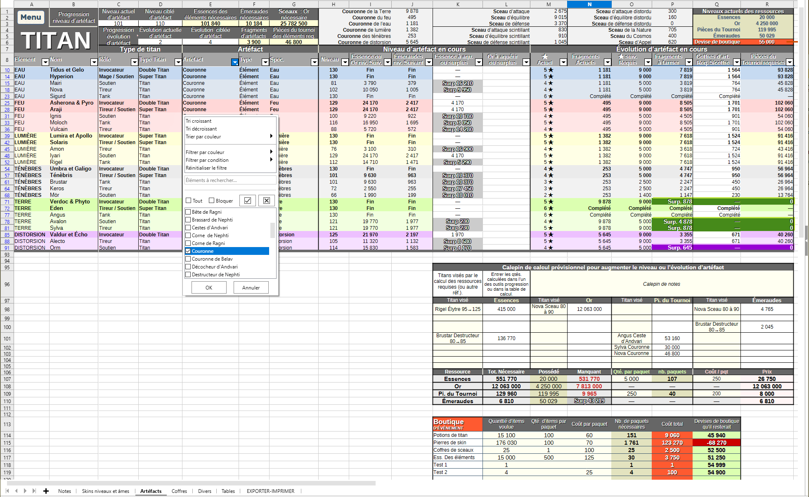
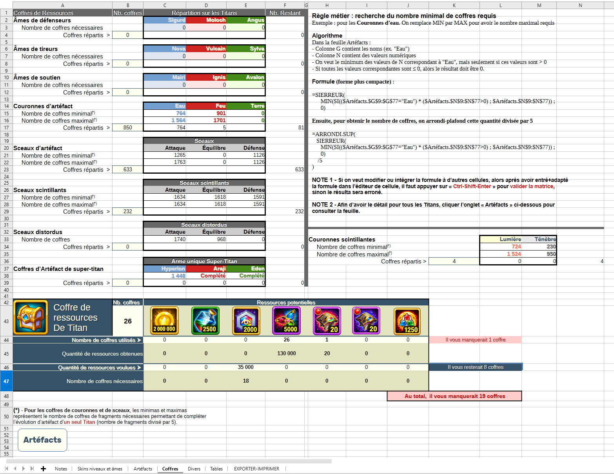
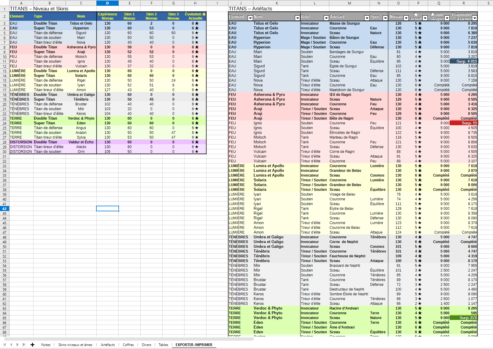

# TitanPlan - Hero Wars Dominion Era sur PC
## Planificateur de ressources pour la progression des Titans

TitanPlan est un **classeur LibreOffice Calc** qui aide à planifier la progression des Titans dans Hero Wars : niveaux d'EXP, skins, artefacts et ressources nécessaires.

> **Prérequis :** la dernière version stable de **LibreOffice** est nécessaire. Téléchargez LibreOffice, qui comprend **Calc**, depuis le **[site officiel](https://fr.libreoffice.org/download/)**.

[Télécharger la dernière version du classeur](https://github.com/ArusPC/Hero-Wars-Titans-Planner/releases/latest)

|  |  |  |  |
|:---:|:---:|:---:|:---:|
| [Fonctions du classeur](#fonctions-du-classeur) | [Démarrage](#démarrage) | [Captures d'écran](#captures-décran) | [Licence](#licence) |

## Fonctions du classeur

### Skins, niveaux et âmes

Dans la feuille **Skins niveaux et âmes**, le classeur permet de :

- calculer les potions et émeraudes nécessaires pour passer un Titan de son niveau actuel à un niveau ciblé ;
- calculer les pierres de skin et les émeraudes nécessaires pour atteindre un niveau de skin ciblé ;
- suivre les niveaux, les skins, les étoiles et les âmes des Titans dans une grille ;
- préparer un calcul prévisionnel avec le **Calepin de notes**, notamment pour estimer les quantités à acheter, les paquets nécessaires et leur coût.

### Artefacts

Dans la feuille **Artéfacts**, le classeur permet de :

- estimer les ressources nécessaires pour améliorer le niveau d'un artefact ou son évolution ;
- suivre les niveaux actuels et ciblés, les fragments, les essences, l'or, les émeraudes et les pièces du tournoi ;
- consulter les besoins par Titan et par artefact, y compris les artefacts d'élément communs ;
- filtrer la grille pour retrouver les artefacts correspondant aux critères voulus ;
- utiliser le **Calepin de calcul prévisionnel** pour regrouper les ressources nécessaires et estimer les achats, les paquets et leur coût.

### Coffres

La feuille **Coffres** estime les nombres minimal et maximal de coffres nécessaires pour différents types de ressources et permet de répartir les coffres prévus. Elle présente aussi les ressources que les coffres peuvent fournir et compare les quantités obtenues aux quantités visées.

### Exportation et impression

La feuille **EXPORTER-IMPRIMER** rassemble les données de progression des niveaux et des skins ainsi que celles des artefacts dans des tableaux destinés à l'exportation ou à l'impression.

### Tables de référence

La feuille **Tables** contient les données de référence utilisées par les calculs. Elle est protégée contre les modifications. Ses données peuvent être copiées, mais ne doivent pas être modifiées ni effacées.

## Démarrage

1. Téléchargez le classeur depuis la [dernière Release](https://github.com/ArusPC/Hero-Wars-Titans-Planner/releases/latest), puis ouvrez le fichier `.ods` avec LibreOffice Calc.
2. Dans les feuilles **Skins niveaux et âmes** et **Artéfacts**, entrez vos valeurs actuelles et vos objectifs dans les cellules prévues à cet effet. Les outils ont besoin de ces saisies pour calculer les résultats.
3. Pour les calculs prévisionnels, entrez les quantités recherchées, celles que vous possédez déjà et les paramètres d'achat demandés dans le **Calepin de notes** ou le **Calepin de calcul prévisionnel**.
4. Utilisez les filtres de la grille des Titans pour afficher les lignes qui vous intéressent.

La protection de certaines feuilles peut être désactivée sans mot de passe, mais ce n'est pas conseillé. Les cellules vides des autres feuilles peuvent être utilisées pour vos notes personnelles.

## Captures d'écran

Cliquez sur une capture pour l'ouvrir en grand format.

<table>
  <tr>
    <td align="center">
       
      <strong>Niveaux, skins et calepin prévisionnel</strong>
    </td>
    <td align="center">
       
      <strong>Grille de progression des artefacts</strong>
    </td>
  </tr>
  <tr>
    <td align="center">
       
      <strong>Calcul prévisionnel des ressources et achats</strong>
    </td>
    <td align="center">
       
      <strong>Filtres de la grille des artefacts</strong>
    </td>
  </tr>
  <tr>
    <td align="center">
       
      <strong>Calcul et répartition des coffres</strong>
    </td>
    <td align="center">
       
      <strong>Exportation et impression</strong>
    </td>
  </tr>
</table>

<!--
## Soutenir le projet

Si ce classeur vous est utile et que vous souhaitez soutenir son développement, vous pouvez le faire sur [Patreon](https://www.patreon.com/VOTRE_NOM). C'est facultatif et cela ne change ni la licence ni les conditions d'accès au classeur.

**À faire avant publication :** remplacer `MON_NOM` par l'adresse réelle de la page Patreon lorsqu'elle sera créé.
-->

## Licence
> **Licence propriétaire.** *Usage personnel ou interne autorisé&nbsp;; redistribution, publication en ligne et diffusion de versions modifiées interdites sans autorisation écrite de l’auteur. Consultez [le résumé et les liens](LICENSE.md) et le [texte complet en français](LICENSE-FR.md).*

[⬆ Retour en haut](#haut)
